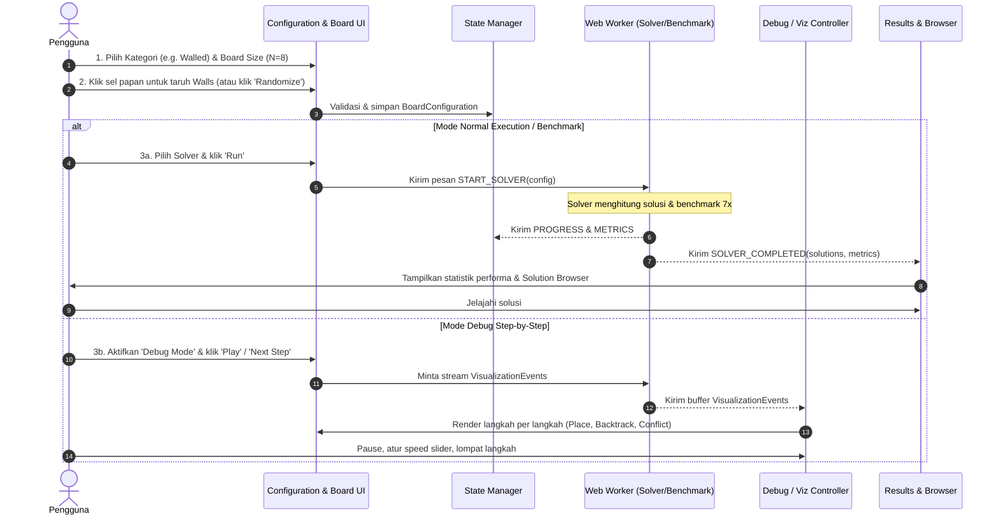

# N-Queen Algorithm Tester & Visualizer — Project Plan & Architecture

Dokumen ini berisi rancangan arsitektur, spesifikasi teknis, struktur folder, kontrak data, alur interaksi pengguna, strategi integrasi WebAssembly/C++, serta rincian milestone pengerjaan untuk proyek **N-Queen Algorithm Tester & Visualizer**.

---

## 1. Arsitektur Aplikasi

Aplikasi dibangun dengan prinsip **Decoupled Architecture**, **Event-Driven Communication**, dan **Modular Components**. UI tidak pernah melakukan komputasi berat di UI thread; semua eksekusi solver dan simulasi benchmark dialirkan melalui **Web Worker**.

```mermaid
flowchart TD
    subgraph UI_Thread["Main UI Thread (Vite + TypeScript)"]
        UI[App Shell / Dashboard Layout]
        Header[Header & Theme Toggle]
        ConfigPanel[Configuration Panel]
        BoardRenderer[Interactive Chessboard & Visualizer]
        ExecPanel[Execution Control Panel]
        DebugPanel[Debug / Step Visualizer]
        ResultsPanel[Results & Solution Browser]
        ComparePanel[Algorithm Comparison Panel]
        
        StateManager[State Manager / Store]
        WorkerBridge[Worker Bridge Service]
        Validator[Solution & Board Validator]
        
        UI --> StateManager
        ConfigPanel --> StateManager
        ExecPanel --> StateManager
        StateManager --> BoardRenderer
        StateManager --> DebugPanel
        StateManager --> ResultsPanel
        StateManager --> ComparePanel
        StateManager <--> WorkerBridge
        ResultsPanel <--> Validator
    end

    subgraph Worker_Thread["Background Web Worker Thread"]
        WorkerRouter[Worker Message Router]
        SolverRegistry[Solver Registry / Manager]
        BenchmarkEngine[Benchmark Runner (Warmup + 7 Runs + MAD)]
        MockSolver[Mock / Simulated Solver]
        WasmGlue["WASM Solver Wrapper (Future C++17)"]
        
        WorkerRouter <--> SolverRegistry
        WorkerRouter <--> BenchmarkEngine
        SolverRegistry --> MockSolver
        SolverRegistry -.-> WasmGlue
    end

    WorkerBridge <== "PostMessage (Commands / Event Stream)" ==> WorkerRouter
```

### Prinsip Utama Arsitektur:
1. **Generic Event-Driven Visualization**: Visualisasi debug tidak terikat pada algoritma backtracking. Solver mengirimkan stream `VisualizationEvent` generic (seperti `QUEEN_PLACE`, `QUEEN_REMOVE`, `CONFLICT_DETECTED`, `SOLUTION_FOUND`, `STATE_EVALUATED`). UI cukup memetakan event tersebut ke papan catur.
2. **Pluggable Solver Interface**: Solver diimplementasikan sebagai kelas atau modul independen yang mengimplementasikan `ISolver`. Menambah algoritma baru hanya memerlukan pendaftaran solver ke `SolverRegistry` tanpa merombak UI.
3. **Non-Blocking Execution**: Web Worker menangani proses pencarian solusi dan pengujian benchmark 7x, sehingga UI tetap responsif, tombol `Stop` dapat langsung menghentikan worker (via `worker.terminate()`), dan animasi tidak tersendat.
4. **Offline & Zero-Backend**: Seluruh komputasi berjalan di browser pengguna secara lokal (Client-side execution).

---

## 2. Struktur Folder Proyek

```
Kuliah-Projek-AnalisisAlgoritme-NQueen/
├── public/
│   ├── favicon.svg
│   └── assets/
│       └── icons/
├── src/
│   ├── app.ts                        # Entry point inisialisasi aplikasi
│   ├── types/
│   │   ├── problem.ts                # Tipe konfigurasi masalah (Normal, Preplaced, Holes, Walled)
│   │   ├── solver.ts                 # Kontrak interface Solver, SolverResult, dan SolverMetrics
│   │   ├── visualization.ts         # Generic VisualizationEvent & animation state
│   │   ├── benchmark.ts              # Struktur data benchmark (7 runs, MAD, memory, timeout)
│   │   └── worker-messages.ts        # Protokol PostMessage antara Main Thread & Web Worker
│   ├── state/
│   │   ├── app-state.ts              # Central reactive state / store
│   │   └── event-emitter.ts          # Event bus untuk decoupling antar-komponen
│   ├── core/
│   │   ├── validator.ts              # Validasi aturan N-Queen (Holes, Walls Raycasting, Duplicate)
│   │   ├── metrics.ts                # Kalkulasi statistik (Median, MAD, Min, Max)
│   │   └── config-generator.ts       # Generator random valid config untuk Holes/Walls/Preplaced
│   ├── components/
│   │   ├── header/
│   │   │   ├── header.ts
│   │   │   └── theme-toggle.ts
│   │   ├── config/
│   │   │   ├── config-panel.ts
│   │   │   └── problem-selectors.ts
│   │   ├── board/
│   │   │   ├── board-renderer.ts     # Render papan catur N x N, hover tooltip, click actions
│   │   │   ├── cell-renderer.ts      # Rendering Queen, Locked Queen, Hole, Wall, Attack lines
│   │   │   └── legend.ts             # Panduan visual papan
│   │   ├── controls/
│   │   │   ├── execution-controls.ts # Play, Stop, Reset, Speed, Debug toggle
│   │   │   └── progress-bar.ts
│   │   ├── debug/
│   │   │   ├── debug-panel.ts        # Step-by-step controller (Next, Prev, Auto-play)
│   │   │   └── event-log.ts          # Daftar riwayat event langkah eksekusi
│   │   ├── results/
│   │   │   ├── results-panel.ts      # Kartu metrik hasil (waktu, memori, iterasi, solusi)
│   │   │   └── solution-browser.ts   # Paginasi/dropdown penjelajah semua solusi
│   │   └── comparison/
│   │       ├── comparison-panel.ts   # Multi-solver benchmark UI
│   │       ├── comparison-table.ts   # Tabel perbandingan performa
│   │       └── comparison-charts.ts  # Bar chart visualisasi waktu eksekusi & memori
│   ├── worker/
│   │   ├── solver.worker.ts          # Web Worker thread entry point
│   │   ├── solver-registry.ts        # Registry pengelola solver yang terdaftar
│   │   ├── benchmark-runner.ts       # Runner benchmark (Warmup + 7x execution)
│   │   └── solvers/
│   │       ├── base-solver.ts        # Abstract class / interface solver
│   │       ├── mock-backtracking.ts  # Mock solver simulasi backtracking
│   │       ├── mock-heuristic.ts     # Mock solver simulasi local search / min-conflicts
│   │       └── mock-walled-solver.ts # Mock solver khusus kategori Walled
│   ├── styles/
│   │   ├── main.css                  # Global style & layout grid
│   │   ├── variables.css             # Design tokens (Light/Dark themes, colors, typography)
│   │   ├── components/               # CSS modular per komponen
│   │   │   ├── board.css
│   │   │   ├── config.css
│   │   │   ├── controls.css
│   │   │   ├── debug.css
│   │   │   ├── results.css
│   │   │   └── comparison.css
│   │   └── responsive.css            # Adaptasi layout laptop & desktop
│   └── wasm/                         # Directory persiapan WebAssembly C++
│       ├── cpp/                      # Source C++17 (akan diisi kemudian)
│       │   ├── include/
│       │   │   └── solver_interface.hpp
│       │   └── src/
│       └── glue/                     # Wrapper JS untuk Emscripten output
├── index.html                        # Template HTML dashboard
├── vite.config.ts                    # Konfigurasi Vite
├── tsconfig.json                     # Konfigurasi TypeScript
├── package.json
└── PLAN.md                           # Dokumen perencanaan ini
```

---

## 3. Komponen Utama & Tanggung Jawab

| Komponen | Tanggung Jawab |
|---|---|
| **Header** | Menampilkan branding, status sistem, quick info modal, dan switch theme Dark/Light mode (disimpan di `localStorage`). |
| **Configuration Panel** | Memilih kategori problem (Normal, Pre-placed, Holes, Walled), slider ukuran N (4–12), input spesifik per kategori, solver selector, serta tombol aksi (Randomize, Reset, Clear, Validate). |
| **Interactive Board Visualizer** | Menampilkan grid papan catur berukuran fleksibel (CSS Grid/SVG). Mendukung mode edit (klik sel untuk menaruh Locked Queen / Hole / Wall) dan mode visualisasi (menampilkan Queen solusi, animasi penempatan, dan garis serang/konflik). |
| **Execution Control Panel** | Mengatur siklus hidup komputasi: Mulai (Run), Hentikan (Stop), Reset, toggle Debug Mode, dan slider kecepatan animasi (delay 10ms - 1000ms). Menampilkan status: `IDLE`, `RUNNING`, `COMPLETED`, `STOPPED`, `ERROR`. |
| **Visualization / Debug Panel** | Kontrol playback langkah demi langkah (Play, Pause, Step Next, Step Prev, Restart), log event real-time (baris, kolom, tipe event, status validitas). |
| **Results Panel** | Menampilkan rangkuman eksekusi: total solusi, waktu (Total, Rata-rata, Median, Min, Max), estimasi memori, jumlah iterasi/node. Menampilkan metrik khusus Walled (Queen Maksimum & Jumlah Solusi Optimal). Menampilkan `N/A` jika metrik tidak didukung solver. |
| **Solution Browser** | Navigasi seluruh solusi yang ditemukan (Prev, Next, Page jump), preview instan solusi terpilih langsung di papan catur utama dengan badge status validasi. |
| **Algorithm Comparison** | Memilih 2 atau lebih solver untuk diuji pada konfigurasi yang persis sama. Menampilkan chart perbandingan waktu, memori, dan tabel rangkuman pemenang (best performer). |
| **Problem Validator** | Engine independen yang memvalidasi keabsahan konfigurasi awal maupun keabsahan solusi akhir (termasuk algoritma *Raycasting Line-of-Sight* untuk kategori Walls). |

---

## 4. Alur Interaksi Pengguna (User Flow)



---

## 5. Kontrak Data & Generic Interfaces

Berikut adalah kontrak TypeScript baku yang memisahkan UI dari implementasi algoritma:

```typescript
// 1. Kategori Masalah
export type ProblemCategory = 'normal' | 'preplaced' | 'holes' | 'walled';

export interface BoardCoordinate {
  row: number;
  col: number;
}

export interface BoardConfiguration {
  category: ProblemCategory;
  n: number; // 4 to 12
  lockedQueens: BoardCoordinate[];
  holes: BoardCoordinate[];
  walls: BoardCoordinate[];
}

// 2. Generic Visualization Event
export type VizEventType = 
  | 'QUEEN_PLACE' 
  | 'QUEEN_REMOVE' 
  | 'CHECK_CELL' 
  | 'CONFLICT_DETECTED' 
  | 'BACKTRACK' 
  | 'VALID_POSITION' 
  | 'SOLUTION_FOUND'
  | 'INFO';

export interface VisualizationEvent {
  type: VizEventType;
  row?: number;
  col?: number;
  stepIndex: number;
  description: string;
  payload?: Record<string, unknown>;
}

// 3. Solver Output & Metrics
export interface Solution {
  id: number;
  queenPositions: BoardCoordinate[]; // posisi tiap queen
  isValid?: boolean;
}

export interface SolverMetrics {
  totalExecutionTimeMs: number;
  avgExecutionTimeMs?: number;
  medianExecutionTimeMs?: number;
  minExecutionTimeMs?: number;
  maxExecutionTimeMs?: number;
  madMs?: number; // Median Absolute Deviation
  memoryUsageKb?: number;
  nodesExplored?: number;
  iterations?: number;
  maxQueensFound?: number; // Khusus Walled
  optimalSolutionsCount?: number; // Khusus Walled
}

export interface SolverResult {
  solverId: string;
  status: 'COMPLETED' | 'STOPPED' | 'TIMEOUT' | 'ERROR';
  solutions: Solution[];
  metrics: SolverMetrics;
  error?: string;
}

// 4. Standar Interface Solver
export interface ISolver {
  readonly id: string;
  readonly name: string;
  readonly description: string;
  readonly supportedCategories: ProblemCategory[];
  
  solve(
    config: BoardConfiguration, 
    onEvent?: (event: VisualizationEvent) => void
  ): Promise<SolverResult>;
}
```

---

## 6. Strategi Integrasi Solver C++17 & WebAssembly

Saat algoritma solver ditulis dalam C++17 dan dikompilasi dengan Emscripten ke WebAssembly (`.wasm` + `.js` glue code), integrasinya dirancang mulus tanpa menyentuh UI layer:

1. **C++17 Standar Interface**:
   ```cpp
   // cpp/include/solver_interface.hpp
   struct CppBoardConfig {
       int n;
       int category; // 0=normal, 1=preplaced, 2=holes, 3=walled
       int* lockedQueens; // array [r1, c1, r2, c2...]
       int lockedCount;
       int* holes;
       int holesCount;
       int* walls;
       int wallsCount;
   };
   
   extern "C" {
       void initSolver();
       char* solveProblemJSON(const char* configJSON);
       void cancelSolver();
   }
   ```
2. **Emscripten Module Wrapper di TypeScript**:
   Modul WebAssembly dibungkus dalam adapter class `WasmSolverAdapter` yang mengimplementasikan `ISolver`. Adapter ini mem-parse output JSON dari WASM dan mengembalikannya dalam bentuk `SolverResult`.
3. **Web Worker Isolation**:
   File `.wasm` di-load langsung di dalam `solver.worker.ts`. Dengan cara ini, komputasi berkecepatan tinggi dari C++ berjalan 100% di background thread tanpa menimbulkan freeze sedikit pun pada UI atau visualisasi catur.

---

## 7. Rincian Milestone & Rencana Pengerjaan

### Milestone 1: Fondasi Proyek, Tooling & Design System
- [x] Inisialisasi Vite + TypeScript pada workspace `Kuliah-Projek-AnalisisAlgoritme-NQueen`.
- [x] Pembuatan CSS Design System (Neo-Brutalist Bauhaus style, Tailwind config, Dark/Light mode).
- [x] Implementasi Shell Dashboard responsif (Header, 3-Column Bauhaus Grid layout, Sidebar Nav).
- [x] Setup Theme Manager (persistensi tema di `localStorage` & HTML class toggle).

### Milestone 2: Configuration Panel & Interactive Chessboard
- [x] Pembuatan komponen `ConfigurationPanel`:
  - Selector kategori (Normal, Pre-placed, Holes, Walled).
  - Slider ukuran papan $N$ ($4 \le N \le 12$) dengan indikator visual.
  - Form & count counter untuk item spesifik (jumlah locked queen, holes, walls).
  - Selector solver (menampilkan daftar solver dari registry).
  - Aksi konfigurasi: *Random Configuration*, *Reset*, *Clear Board*, *Validate Configuration*.
- [x] Pembuatan komponen `BoardRenderer`:
  - Rendering grid catur fleksibel sesuai ukuran $N$.
  - Koordinat papan (A-L dan 1-12) dengan hover preview.
  - Visualisasi ikon khusus: Queen, Locked Queen, Holes (lubang), Walls (bata/blok).
  - Mode interaktif: klik sel pada papan untuk menempatkan/menghapus Locked Queen, Hole, Wall, atau Clear.
  - Legenda visual lengkap di bawah papan.

### Milestone 3: Execution Engine, Web Worker & Generic Visualizer
- [x] Setup arsitektur Web Worker (`solver.worker.ts`) dan protokol komunikasi dua arah via `WorkerBridge`.
- [x] Implementasi Solvers & Mock Solvers:
  - Recursive Backtracking Solver dengan raycasting wall occlusion.
  - Bitwise Solver Simulation.
  - CSP (Forward Checking + MRV) Simulation.
  - Greedy Max-Queens Wall Solver Simulation.
- [x] Pembuatan `ExecutionControls`:
  - Tombol Run/Pause, Step, Stop.
  - Status indicator (Idle, Running, Paused, Completed, Stopped, Error).
  - State locking: form konfigurasi di-disable saat komputasi berlangsung.
- [x] Pembuatan Debug Visualization Terminal:
  - Step stream playback dengan speed slider (200ms, 50ms, 10ms, 0ms Instant).
  - Terminal log visualizer yang menampilkan baris, kolom, tipe aksi, dan deskripsi event.
  - Highlight real-time pada papan: sel yang sedang diperiksa, jalur serang (attack lines), dan dinding penghalang.

### Milestone 4: Results Manager, Solution Browser & Solution Validator
- [x] Pembuatan `ProblemValidator` (Rule Engine):
  - Validasi konflik horizontal, vertikal, dan diagonal.
  - Validasi penempatan pada sel holes dan walls.
  - Validasi aturan walls: dinding menghalangi sinar serangan antar dua queen (*raycasting line-of-sight*).
  - Pengecekan keunikan solusi (deteksi duplikasi).
- [x] Pembuatan `ResultsPanel`:
  - Kartu statistik performa (Total Solusi, Waktu Total, Memori, Nodes/Iterasi).
  - Kartu khusus untuk kategori Walled (Jumlah Queen Maksimum & Banyaknya Solusi Optimal).
- [x] Pembuatan `SolutionBrowser`:
  - Mini 8x8 Thumbnail Preview dari solusi yang dipilih.
  - State vector generator (misal `[1, 5, 8, 6, 3, 7, 2, 4]`).
  - Tombol Previous dan Next Solution (langsung merender papan catur utama).
  - Tombol Copy Vector ke Clipboard dan Export JSON file.

### Milestone 5: Benchmarking Engine & Multi-Algorithm Comparison
- [x] Pembuatan `BenchmarkRunner` di Web Worker:
  - 1x validasi awal.
  - 1x warm-up run.
  - 7x pengukuran waktu eksekusi presisi (`performance.now()`).
  - Solver baru (fresh instance) pada setiap pengujian.
  - Perhitungan statistik: Best, Median, Min, Max, Median Absolute Deviation (MAD), dan estimasi peak memory.
- [x] Pembuatan `ComparisonPanel`:
  - Multiselect opsi pemilihan lebih dari 1 algoritma.
  - Pengujian massal terhadap konfigurasi papan yang sama dengan progress bar interaktif.
  - Tabel perbandingan performa 7-run terperinci (Median, MAD, Min, Max, Nodes).
  - Grafik visual (Bar Chart) untuk waktu eksekusi dan konsumsi memori.
  - Highlight kartu ringkasan algoritma terbaik (*Best Performer*).

### Milestone 6: WebAssembly / C++ Readiness, Polish & Dokumentasi
- [x] Pembuatan interface C++ header (`src/wasm/cpp/include/solver_interface.hpp`).
- [x] Pembuatan Docs & Architecture panel di dalam dashboard UI.
- [x] Verifikasi build produksi Vite (`npm run build` sukses 0 errors).

---

## 8. Verifikasi & Definisi Selesai (Definition of Done)
1. Aplikasi berjalan lancar via `npm run dev` (Vite) tanpa error console.
2. Seluruh 4 kategori permasalahan (Normal, Pre-placed, Holes, Walled) dapat dikonfigurasi lewat panel dan lewat klik papan langsung.
3. Kontrol eksekusi dan visualisasi debug dapat di-play, pause, step forward/backward dengan kecepatan yang dapat diatur.
4. UI tetap responsif 100% dan tidak mengalami freeze selama proses komputasi berlangsung (berkat Web Worker).
5. Seluruh solusi yang dihasilkan mock solver dapat dijelajahi di Solution Browser dan dirender di papan.
6. Halaman perbandingan dapat menampilkan komparasi beberapa solver beserta grafik bar chart.
7. Tema Dark dan Light mode berfungsi dengan kontras warna yang nyaman dibaca.
